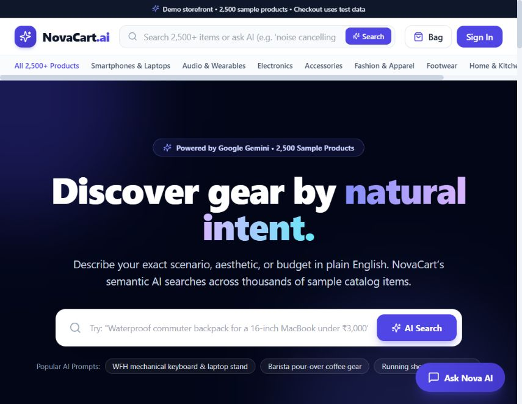

# NovaCart AI

An AI-assisted ecommerce demo built with React, TypeScript, Express, MongoDB, and Google Gemini. Browse a sample catalog, ask for product recommendations, and manage products and orders from an admin dashboard.

**[Live storefront](https://novacart-updated-preview.vercel.app)** · **[Admin sign-in](https://novacart-updated-preview.vercel.app/login)** · **[Deployment guide](VERCEL.md)**



> **Project status:** working demonstration with 2,500 sample products. Checkout includes simulated payments and is not ready to process real purchases. See [production readiness](#production-readiness) before adapting it for a business.

This README describes **`novacart-updated-preview`**, the TypeScript branch used for the Vercel preview. The repository's `main` branch contains a separate JavaScript implementation with additional checkout hardening; reconcile the implementations before merging them.

## Contents

- [Features](#features)
- [Technology and structure](#technology-and-structure)
- [Run locally](#run-locally)
- [Admin access](#admin-access)
- [Configuration](#configuration)
- [Deploy to Vercel](#deploy-to-vercel)
- [Build and verification](#build-and-verification)
- [Troubleshooting](#troubleshooting)
- [Production readiness](#production-readiness)

## Features

| Area | Included functionality |
| --- | --- |
| Storefront | Search suggestions, category/brand/price/rating/stock filters, sorting, pagination, product variants, and reviews |
| Shopping | Persistent browser cart, wishlist, demo coupons, checkout simulator, cash-on-delivery flow, and order history |
| Accounts | Registration, sign-in, profile editing, JWT cookies, and administrator authorization |
| Administration | Product management, order status updates, low-stock summaries, and basic sales charts |
| Gemini AI | Shopping recommendations, natural-language product search, text/image-assisted listing generation, and review summaries |
| Deployment | Vite frontend and Express API served together on Vercel, backed by cloud MongoDB |

Natural-language search uses Gemini to extract search parameters, then queries MongoDB; it does not use a vector database. Review summaries require at least **three reviews** on a product. The hosted preview has no seeded reviews, so summaries become available after reviews are added.

### Integration status

| Service | Hosted preview status |
| --- | --- |
| MongoDB Atlas | Connected to a dedicated preview database with 2,500 sample products |
| Google Gemini | Configured; shopping recommendations verified |
| Razorpay | Integration code included; credentials and complete payment flow have not been configured or verified |
| Cloudinary | Optional, currently unconfigured; image uploads fall back to base64 data URLs |
| Stripe | Backend payment-intent endpoint included; no Stripe checkout UI or configured credentials |

## Technology and structure

- **Frontend:** React 18, TypeScript, Vite 6, Tailwind CSS, React Router, Framer Motion, Recharts.
- **Backend:** Node.js 22, Express 4, MongoDB, Mongoose, JWT, bcrypt.
- **AI:** Google Gemini through `@google/genai`.
- **Hosting:** Vercel frontend and serverless API; MongoDB Atlas for persistent hosted data.

```text
.
├── api/index.js             # Vercel entry point for Express
├── client/src/
│   ├── components/         # Storefront, admin, and AI components
│   ├── context/            # Authentication and cart state
│   ├── pages/              # Storefront, account, checkout, and admin pages
│   └── types/              # Frontend types
├── server/
│   ├── config/             # Database and Gemini setup
│   ├── controllers/        # Request handlers
│   ├── middleware/         # Authentication, uploads, and error handling
│   ├── models/             # Users, products, and orders
│   ├── routes/             # API routes
│   ├── services/           # Gemini operations
│   └── utils/              # Demo seeder and token helpers
├── local-preview/          # Isolated local MongoDB and configuration helpers
├── docs/images/            # README screenshots
├── vercel.json             # Build settings and frontend/API routing
└── VERCEL.md               # Hosted deployment notes
```

## Run locally

### Prerequisites

Use **Node.js 22.x**, npm, and Git. The first launch needs an internet connection to install packages and download MongoDB. A Gemini key is needed only for AI features; basic storefront features work without optional service keys.

### 1. Clone and install

```sh
git clone --branch novacart-updated-preview https://github.com/ankush-48/mern-ai-ecommerce.git
cd mern-ai-ecommerce
npm ci --prefix server
npm ci --prefix client
npm install --prefix local-preview
```

### 2. Start the local database and API

```sh
npm start --prefix local-preview
```

On first launch, the helper downloads MongoDB 8.0.16, starts an isolated database on port **27018**, and seeds **2,500 sample products**, demo accounts, and synthetic reviews. It creates local environment files and a persistent random login-signing secret. Later launches reuse data in `local-preview/db/`.

Keep this terminal running. Use **Ctrl+C** to stop the API and local database.

### 3. Start the frontend in a second terminal

From the repository root:

```sh
npm run dev --prefix client -- --host 127.0.0.1
```

Open **[http://localhost:5173](http://localhost:5173)**. Vite forwards `/api` requests to the API on port **5000**.

### Using your own development MongoDB

Instead of the local preview helper, create `server/.env` from [`server/.env.example`](server/.env.example), set `MONGO_URI` and a unique `JWT_SECRET`, then run `npm run dev --prefix server`. Start the frontend as above.

For sample data, `npm run seed --prefix server` runs the demo seeder. **It deletes all existing users, products, and orders in the configured database. Use it only with a disposable development database.**

## Admin access

Sign in at `/login`, then open `/admin`. Signing in initially returns you to the storefront.

The following accounts are created by the **local demo seeder only**:

| Role | Email | Local demo password |
| --- | --- | --- |
| Admin | `admin@novacart.ai` | `Admin@123` |
| Customer | `customer@novacart.ai` | `Customer@123` |

**Hosted access is separate:** the deployed administrator uses a private generated password. The public local demo passwords do not grant hosted admin access, even if the sign-in screen shows the local demo hint. Hosted credentials are not stored in this repository; obtain them from the deployment owner.

## Configuration

Secrets are excluded from Git and are not transferred when you clone the repository. Use `server/.env` locally and the project's environment settings on Vercel.

| Variable | Purpose |
| --- | --- |
| `MONGO_URI` | MongoDB connection string; required for database-backed routes |
| `JWT_SECRET` | Unique signing secret for login sessions; required |
| `NODE_ENV` | `development` locally; `production` when hosted |
| `PORT` | Local API port; defaults to `5000` |
| `CLIENT_URL` | Allowed frontend origin; locally `http://localhost:5173` |
| `JWT_EXPIRE` | Token lifetime; defaults to `7d` |
| `GEMINI_API_KEY` | Server-side Gemini key for AI features |
| `GEMINI_MODEL` | Model override; current code default is `gemini-3.5-flash-lite` |
| `CLOUDINARY_CLOUD_NAME`, `CLOUDINARY_API_KEY`, `CLOUDINARY_API_SECRET` | Configure all three to use Cloudinary uploads |
| `RAZORPAY_KEY_ID`, `RAZORPAY_KEY_SECRET` | Optional backend Razorpay test credentials |
| `STRIPE_SECRET_KEY` | Optional backend Stripe test credential; checkout UI is not implemented |
| `VITE_API_URL` | Frontend API URL; defaults to `/api` for the development proxy and Vercel |
| `VITE_RAZORPAY_KEY_ID` | Public Razorpay test key ID, set in `client/.env.local` if testing that integration |

Only the public Razorpay key ID belongs in the frontend. Vite exposes `VITE_*` values in the browser bundle; keep API secrets and database credentials on the server.

### Optional local configuration form

```sh
npm run keys --prefix local-preview
```

Open **[http://127.0.0.1:5175](http://127.0.0.1:5175)** to enter service credentials. Empty fields preserve existing values, and payment credentials are restricted to test keys. Stop the form after saving and restart the API and frontend to apply changes.

## Deploy to Vercel

Use **`novacart-updated-preview`** with the **repository root** as the Vercel project root. [`vercel.json`](vercel.json) supplies the install command, builds `client/dist`, routes `/api/*` to the Express function, and handles React page refreshes.

Configure `MONGO_URI`, `JWT_SECRET`, `NODE_ENV=production`, and `CLIENT_URL` in Vercel. Add `GEMINI_API_KEY` and `GEMINI_MODEL` for AI features. Use a persistent cloud database; the local MongoDB helper is not part of the hosted runtime.

See **[VERCEL.md](VERCEL.md)** for the deployment configuration and hosted preview details.

## Build and verification

```sh
npm run build
```

This runs the TypeScript compiler and Vite production build. There is currently no automated test suite in this preview branch.

For a local or hosted smoke check:

1. Open `/api/health` to check that the API responds. This endpoint does **not** check database connectivity.
2. Open `/api/products?limit=1` to verify catalog access through MongoDB.
3. Refresh `/shop` directly to check frontend routing.
4. Sign in with an administrator account and open `/admin` to check access.
5. With Gemini configured, ask the shopping assistant for a recommendation.

The hosted preview has been checked for frontend rendering, catalog access, route refreshes, authenticated admin access, and Gemini shopping recommendations. Payment integrations remain unverified.

## Troubleshooting

| Symptom | Check |
| --- | --- |
| Frontend opens but products do not load | Keep the local preview terminal running; check port `5000` and `/api/products?limit=1` |
| First local startup takes time | MongoDB must download before the first seed; check the terminal and internet connection |
| Database unavailable on Vercel | Check the cloud connection string, database-user permissions, and network access rules |
| AI requests fail | Check the server's Gemini key, account quota, and model availability; restart or redeploy after configuration changes |
| Review summaries are unavailable | Add at least three reviews to the product |
| Local demo password fails on the hosted site | Use the hosted administrator's private credentials |
| Configuration changes have no effect | Restart local services, or redeploy after updating hosted environment variables |

## Production readiness

This is a demonstration application, not an enterprise-ready payment system. Before accepting real customers or transactions:

- Reconcile the checkout hardening on `main` with this TypeScript implementation.
- Calculate prices, discounts, taxes, and totals on the server; the current flow trusts client-supplied amounts.
- Replace simulated payment success with provider-verified payment handling, webhook verification, and idempotency.
- Make inventory and order updates transactional and resilient to retries and concurrent checkout.
- Review authentication, request validation, abuse controls, dependency security, and automated test coverage.
- Add operational monitoring, database backup/recovery, and appropriate data-retention controls.

Admin charts are demo summaries: order data is limited to the latest 100 orders, and category revenue is an estimate. They should not be used as accounting records.
